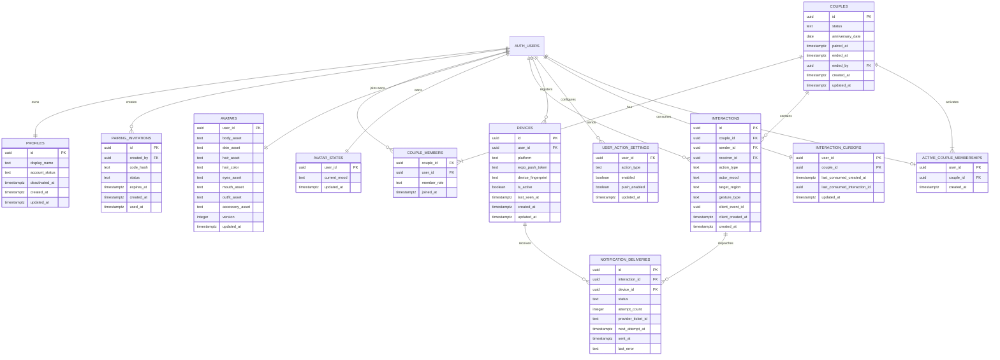

# Mô hình dữ liệu Couple App

## 1. Mục tiêu

Mô hình dữ liệu cần hỗ trợ:

- Một tài khoản có tối đa một quan hệ đang hoạt động.
- Ghép đôi bằng invitation có thời hạn.
- Cả hai thành viên đọc được dữ liệu chung của cặp.
- Mỗi người chỉ sửa hồ sơ, avatar và setting của chính mình.
- Interaction được lưu bền vững và có thể gửi push an toàn.
- Ngắt ghép đôi có hiệu lực ngay mà không cần xóa toàn bộ lịch sử tức thời.

## 2. Sơ đồ quan hệ

## 3. Enum và trạng thái

### Couple status

| Giá trị | Ý nghĩa |
|---|---|
| `active` | Cặp đang hoạt động |
| `ended` | Một thành viên đã ngắt ghép đôi |

MVP không cần trạng thái `paused`. Invitation quản lý trạng thái trước khi cặp được tạo.

### Invitation status

| Giá trị | Ý nghĩa |
|---|---|
| `active` | Có thể sử dụng |
| `used` | Đã dùng thành công |
| `expired` | Đã hết hạn |
| `revoked` | Người tạo đã thu hồi |

### Action type

- `HEAD_PAT`
- `CHEEK_POKE`
- `BONK`
- `KISS`
- `HUG`
- `HUNGRY`
- `MISS_YOU`
- `SLEEPY`
- `PUSH_AWAY`

### Mood type

- `happy`
- `angry`
- `sad`

### Notification delivery status

| Giá trị | Ý nghĩa |
|---|---|
| `not_required` | Không cần gửi push |
| `pending` | Đang chờ gửi |
| `sent` | Provider đã chấp nhận |
| `suppressed` | Bị chặn do setting, quiet hours hoặc rate limit |
| `failed` | Gửi thất bại |

## 4. Bảng `profiles`

`profiles.id` sử dụng cùng UUID với `auth.users.id`.

| Cột | Kiểu | Bắt buộc | Ghi chú |
|---|---|---:|---|
| `id` | uuid | Có | PK và FK tới auth user |
| `display_name` | text | Có | Tên hiển thị trong app |
| `account_status` | text/enum | Có | `active` hoặc `deactivated` |
| `deactivated_at` | timestamptz | Không | Có khi user soft delete |
| `created_at` | timestamptz | Có | Server-generated |
| `updated_at` | timestamptz | Có | Server-generated |

Ràng buộc:

- `display_name` sau trim có độ dài hợp lệ, đề xuất 1-40 ký tự.
- Không lưu email lặp lại nếu có thể đọc từ hệ thống auth với quyền phù hợp.
- Partner không query trực tiếp mọi cột profile; API/view chỉ trả field công khai như `display_name`.
- Không lưu birthday trong pilot khi chưa có use case.

## 5. Bảng `pairing_invitations`

| Cột | Kiểu | Bắt buộc | Ghi chú |
|---|---|---:|---|
| `id` | uuid | Có | PK |
| `created_by` | uuid | Có | User tạo lời mời |
| `code_hash` | text | Có | Hash của mã nếu không cần đọc lại từ DB |
| `status` | text/enum | Có | Mặc định `active` |
| `expires_at` | timestamptz | Có | Thời gian hết hạn |
| `created_at` | timestamptz | Có | Thời gian tạo |
| `used_at` | timestamptz | Không | Thời gian dùng thành công |

Ràng buộc:

- Một user chỉ có tối đa một invitation active.
- User đã có couple active không được tạo hoặc sử dụng invitation.
- Người tạo không thể dùng invitation của chính mình.
- Invitation phải single-use.
- V1 dùng mã 12 ký tự hexadecimal viết hoa, hết hạn sau 24 giờ và giới hạn 10 lần preview trong 10 phút cho mỗi account.

## 6. Bảng `couples`

| Cột | Kiểu | Bắt buộc | Ghi chú |
|---|---|---:|---|
| `id` | uuid | Có | PK |
| `status` | text/enum | Có | `active` hoặc `ended` |
| `anniversary_date` | date | Không | Ngày kỷ niệm do hai người đặt |
| `paired_at` | timestamptz | Có | Thời điểm ghép đôi thành công |
| `ended_at` | timestamptz | Không | Có khi kết thúc |
| `ended_by` | uuid | Không | User yêu cầu kết thúc |
| `created_at` | timestamptz | Có | Thời gian tạo |
| `updated_at` | timestamptz | Có | Thời gian cập nhật |

Không hard-delete couple ngay khi kết thúc. Chuyển trạng thái trước để khóa quyền gửi interaction tức thời và hỗ trợ chính sách xóa dữ liệu sau đó.

## 7. Bảng `couple_members`

| Cột | Kiểu | Bắt buộc | Ghi chú |
|---|---|---:|---|
| `couple_id` | uuid | Có | FK tới couples |
| `user_id` | uuid | Có | FK tới auth users |
| `member_role` | text | Có | MVP có thể dùng `member` |
| `joined_at` | timestamptz | Có | Thời gian tham gia |

Khóa chính tổng hợp: `(couple_id, user_id)`.

Ràng buộc nghiệp vụ:

- Một couple active có đúng hai member.
- Một user chỉ thuộc tối đa một couple active.
- Việc tạo couple và hai member phải nằm trong cùng một transaction/server function.

## 8. Bảng `avatars`

| Cột | Kiểu | Bắt buộc | Ghi chú |
|---|---|---:|---|
| `user_id` | uuid | Có | PK và FK tới user |
| `body_asset` | text | Có | ID asset body |
| `skin_asset` | text | Có | ID asset skin |
| `hair_asset` | text | Có | ID asset tóc |
| `hair_color` | text | Không | Token màu nếu asset cho phép đổi màu |
| `eyes_asset` | text | Có | ID asset mắt |
| `mouth_asset` | text | Có | ID asset miệng |
| `outfit_asset` | text | Có | ID trang phục |
| `accessory_asset` | text | Không | ID phụ kiện |
| `version` | integer | Có | Tăng khi format avatar đổi |
| `updated_at` | timestamptz | Có | Thời gian cập nhật |

Client chỉ chấp nhận asset ID tồn tại trong catalog đóng gói hoặc catalog được backend cho phép. Không render URL tùy ý do người dùng nhập.

## 9. Bảng `interactions`

| Cột | Kiểu | Bắt buộc | Ghi chú |
|---|---|---:|---|
| `id` | uuid | Có | PK |
| `couple_id` | uuid | Có | Couple tại thời điểm gửi |
| `sender_id` | uuid | Có | Backend lấy từ JWT |
| `receiver_id` | uuid | Có | Backend suy ra từ couple |
| `action_type` | text/enum | Có | Một action được hỗ trợ |
| `actor_mood` | text/enum | Có | Mood authoritative của sender tại thời điểm resolve |
| `target_region` | text/enum | Có | Ví dụ `head`, `body`, `self_mouth`, `self_heart` |
| `gesture_type` | text/enum | Có | Ví dụ `tap` hoặc `drag_together` |
| `client_event_id` | uuid | Có | Idempotency key do client tạo |
| `client_created_at` | timestamptz | Không | Chỉ dùng hỗ trợ UX/debug, không quyết định quyền |
| `created_at` | timestamptz | Có | Thời gian server chấp nhận |

Ràng buộc và index:

- Unique `(sender_id, client_event_id)`.
- Index `(couple_id, created_at desc)` cho lịch sử.
- Index `(receiver_id, created_at desc)` để lấy action gần nhất.
- Check `sender_id <> receiver_id`.
- Trigger hoặc server validation đảm bảo cả hai là member của cùng couple.

Không cho mobile insert trực tiếp. Edge Function hoặc database function có quyền phù hợp thực hiện insert sau validation.

Không có read receipt công khai và không có `reply_to_interaction_id` trong pilot.

## 10. Bảng `avatar_states`

| Cột | Kiểu | Bắt buộc | Ghi chú |
|---|---|---:|---|
| `user_id` | uuid | Có | PK và FK tới user |
| `current_mood` | text/enum | Có | `happy`, `angry`, `sad`; mặc định `happy` |
| `updated_at` | timestamptz | Có | Dùng cho realtime sync và conflict resolution |

User chỉ cập nhật mood của chính mình. Partner active có thể đọc mood để render biểu cảm avatar. V1 không lưu mood history.

## 11. Bảng `interaction_cursors`

Cursor chỉ phục vụ việc chọn action mới nhất cần phát animation, không được dùng để hiển thị trạng thái đã xem cho partner.

| Cột | Kiểu | Bắt buộc | Ghi chú |
|---|---|---:|---|
| `user_id` | uuid | Có | PK, người nhận action |
| `couple_id` | uuid | Có | PK, scope cursor theo từng relationship |
| `last_consumed_created_at` | timestamptz | Không | Server timestamp của interaction mới nhất đã consume |
| `last_consumed_interaction_id` | uuid | Không | UUID dùng làm tie-breaker; không tạo FK vì interaction có thể bị retention xóa |
| `updated_at` | timestamptz | Có | Thời gian cập nhật cursor |

Khi mở phòng chung, server lấy interaction mới nhất của receiver trong couple hiện tại theo thứ tự `(created_at, id)` nằm sau cursor. Sau khi animation bắt đầu thành công, cursor lưu lại cả `(created_at, id)`. Mỗi couple có cursor riêng nên relationship mới không kế thừa vị trí của relationship cũ. Xóa interaction không làm mất hoặc chặn cursor vì cursor không dùng foreign key tới interaction.

## 12. Bảng `devices`

| Cột | Kiểu | Bắt buộc | Ghi chú |
|---|---|---:|---|
| `id` | uuid | Có | PK |
| `user_id` | uuid | Có | Chủ thiết bị |
| `platform` | text | Có | `ios` hoặc `android` |
| `expo_push_token` | text | Có | Token push |
| `device_fingerprint` | text | Không | ID app-generated, không phải hardware tracking |
| `is_active` | boolean | Có | Cho phép gửi push |
| `last_seen_at` | timestamptz | Có | Lần app cập nhật gần nhất |
| `created_at` | timestamptz | Có | Thời gian tạo |
| `updated_at` | timestamptz | Có | Thời gian cập nhật |

Ràng buộc:

- Unique `expo_push_token`.
- User chỉ đọc và cập nhật device của chính mình.
- Token lỗi vĩnh viễn chuyển `is_active = false`.

## 13. Bảng `user_action_settings`

| Cột | Kiểu | Bắt buộc | Ghi chú |
|---|---|---:|---|
| `user_id` | uuid | Có | Người nhận áp dụng setting |
| `action_type` | text/enum | Có | Action cụ thể |
| `enabled` | boolean | Có | Nếu false, backend từ chối action trước khi insert |
| `push_enabled` | boolean | Có | Có gửi push cho action không |
| `updated_at` | timestamptz | Có | Thời gian cập nhật |

Khóa chính tổng hợp: `(user_id, action_type)`.

Quiet hours và cài đặt notification chung có thể đặt trong bảng `user_notification_settings` riêng khi triển khai, thay vì nhồi tất cả vào `profiles`.

`push_enabled = false` chỉ tắt push, không đồng nghĩa chặn action.

## 14. Bảng tùy chọn `user_notification_settings`

Đề xuất tạo nếu MVP triển khai quiet hours:

| Cột | Kiểu | Bắt buộc | Ghi chú |
|---|---|---:|---|
| `user_id` | uuid | Có | PK |
| `push_enabled` | boolean | Có | Master toggle |
| `content_mode` | text/enum | Có | `generic`, `sender_only` hoặc `detailed`; mặc định `generic` |
| `quiet_hours_enabled` | boolean | Có | Bật quiet hours |
| `quiet_start` | time | Không | Giờ địa phương bắt đầu |
| `quiet_end` | time | Không | Giờ địa phương kết thúc |
| `timezone` | text | Có | IANA timezone |
| `updated_at` | timestamptz | Có | Thời gian cập nhật |

Backend phải xử lý trường hợp khoảng quiet hours đi qua nửa đêm.

## 15. Ma trận quyền truy cập

| Bảng | Đọc | Tạo | Cập nhật | Xóa |
|---|---|---|---|---|
| `profiles` | Chính mình; partner chỉ đọc qua API khi cả hai account active | Chính mình | Chính mình | Qua quy trình xóa tài khoản |
| `pairing_invitations` | Người tạo; lookup hợp lệ qua function | User chưa có couple active | Người tạo revoke | Server cleanup |
| `couples` | Thành viên của couple | Server function | Thành viên cập nhật field cho phép | Không hard-delete trực tiếp |
| `couple_members` | Thành viên cùng couple | Server function | Không trực tiếp | Server process |
| `avatars` | Chính mình và partner khi cả hai account active | Chính mình | Chính mình | Qua xóa tài khoản |
| `avatar_states` | Chính mình và partner khi cả hai account active | Chính mình | Chính mình | Qua xóa tài khoản |
| `interactions` | Sender hoặc receiver | Edge Function | Không cập nhật trực tiếp | Hard delete theo account workflow |
| `devices` | Chính mình | Chính mình | Chính mình | Chính mình |
| `user_action_settings` | Chính mình; backend gửi action được kiểm tra | Chính mình | Chính mình | Chính mình |
| `interaction_cursors` | Chỉ chính mình | Server/chính mình theo API giới hạn | Chỉ chính mình | Khi xóa account |
| `active_couple_memberships` | Chỉ member liên quan qua API | Pairing transaction | Không cập nhật trực tiếp | End-couple transaction |
| `notification_deliveries` | Chỉ server | Cùng transaction với interaction | Worker | Cleanup theo retention |

## 16. Row Level Security nguyên tắc

RLS policy nên dựa trên helper function ổn định, ví dụ kiểm tra user hiện tại có phải thành viên của couple hay không. Tránh lặp query phức tạp trong mọi policy nếu có thể chuẩn hóa an toàn.

Các nguyên tắc bắt buộc:

- `auth.uid()` phải khớp owner cho dữ liệu cá nhân.
- API partner profile/avatar phải kiểm tra `account_status = active` cho cả hai phía.
- Edge Function gửi interaction phải reject nếu sender hoặc receiver deactivated.
- Interaction chỉ đọc được khi `auth.uid()` là sender hoặc receiver.
- Dữ liệu couple chỉ đọc được khi có membership.
- Couple đã ended vẫn có thể cho phép đọc lịch sử theo chính sách retention, nhưng không được tạo interaction mới.
- Invitation lookup không được trả toàn bộ record bằng code đoán được.
- Service role chỉ dùng trong Edge Function/server process.

## 17. Vô hiệu hóa, xóa dữ liệu và retention

Chính sách V1:

- Khi ngắt ghép đôi, khóa gửi interaction và ẩn profile/avatar partner ngay lập tức.
- Interaction của couple ended được giữ 10 ngày rồi xóa tự động.
- Khi user vô hiệu hóa tài khoản, profile bị ẩn, interaction mới bị khóa và account có thể restore bất cứ lúc nào.
- Account deactivated có thể restore bất cứ lúc nào; uninstall app không tự deactivate account.
- Khi user yêu cầu xóa hoàn toàn, đây phải là hard delete workflow chứ không chỉ đổi trạng thái account.
- Hard delete xóa mọi interaction có user là sender hoặc receiver; partner cũng mất các interaction này.
- Invitation hết hạn được cleanup định kỳ.
- Device inactive lâu ngày được cleanup định kỳ.

Hard-delete workflow phải chạy trong quy trình có kiểm soát:

1. Nếu user đang có couple active, chuyển couple sang `ended`.
2. Xóa active membership của cả hai thành viên để partner có thể pair lại.
3. Xóa `couple_members` của user theo FK policy đã chốt.
4. Xóa mọi interaction có user là sender hoặc receiver và các notification delivery liên quan.
5. Xóa device token, cursor, setting, avatar, avatar state và invitation của user.
6. Xóa profile và auth user.

## 18. Active membership invariant

Chỉ kiểm tra "user chưa có couple active" ở Edge Function không an toàn trước hai request đồng thời.

### Phương án đã chọn

Tạo bảng `active_couple_memberships`:

| Cột | Kiểu | Bắt buộc | Ghi chú |
|---|---|---:|---|
| `user_id` | uuid | Có | PK/unique, mỗi user chỉ có một row active |
| `couple_id` | uuid | Có | FK tới couple active |
| `created_at` | timestamptz | Có | Thời gian activate |

Khi pairing, transaction tạo couple, hai couple members và hai active membership. Nếu một user đã có row, database reject transaction. Khi end couple, transaction xóa hai active membership nhưng giữ `couple_members` làm lịch sử.

### Phương án khác

- `active_couple_id` trên profile: ít bảng hơn nhưng trộn relationship state vào profile.
- Advisory lock/row lock: không cần bảng phụ nhưng logic concurrency khó đọc và test hơn.
- Application check đơn thuần: không được khuyến nghị vì có race condition.

Đây là quyết định đã chốt trong `decisions.md`.

## 19. Push delivery model

V1 dùng durable delivery với bảng `notification_deliveries`/outbox gồm ít nhất:

- `interaction_id`
- `device_id`
- `status`
- `attempt_count`
- `provider_ticket_id`
- `next_attempt_at`
- `sent_at`
- `last_error`

Interaction và outbox phải được tạo cùng transaction. Worker kiểm tra couple/action setting trước khi gửi và retry có giới hạn.

## 20. Migration và seed data

Khi bắt đầu code:

- Mọi thay đổi schema phải qua migration có version.
- Không sửa production schema thủ công nếu thay đổi đó cần tái lập ở môi trường khác.
- Seed local chỉ dùng dữ liệu giả.
- Asset manifest đóng gói cần validation ID duy nhất và provenance/license record; không seed database asset catalog trong V1.
- RLS policy phải có automated test cho cả trường hợp được phép và bị từ chối.

## 21. Câu hỏi cần chốt trước migration đầu tiên

- Mood/action mapping cho các vùng ngoài vùng đầu là gì?
- Có cần cho phép user ẩn mood khỏi partner ở phase sau không?
- Backup và log kỹ thuật giữ dữ liệu đã xóa trong bao lâu?
