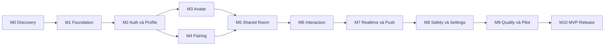

# Roadmap triển khai Couple App

## 1. Mục tiêu

Roadmap này chia MVP thành các milestone có thể kiểm chứng độc lập. Thứ tự ưu tiên nhằm chứng minh interaction loop sớm nhất, đồng thời không bỏ qua authentication, quyền riêng tư và notification.

Phase 1 đã có implementation ban đầu trong repo. Roadmap vẫn là nguồn theo dõi acceptance criteria; một mục chỉ hoàn thành khi đã chạy end-to-end trên Supabase và Android thực tế.

Roadmap được chia thành ba lớp để tránh quá tải:

- Prototype: spike asset, gesture, realtime và notification.
- Android Pilot V1: auth OTP, pairing, avatar preset, bốn interaction intent và core safety.
- Phase 2+: mở rộng action, avatar editor, history, quiet hours, iOS và delivery nâng cao.

## 2. Nguyên tắc triển khai

- Xây theo vertical slice thay vì hoàn thành toàn bộ UI rồi mới nối backend.
- Mỗi milestone phải có acceptance criteria có thể kiểm tra.
- Không thêm feature ngoài MVP nếu chưa giải quyết blocker của core loop.
- Backend là nguồn quyết định quyền gửi interaction.
- Schema, RLS và migration phải đi cùng nhau.
- Tối ưu animation sau khi luồng chức năng đúng và đo được vấn đề.
- Không chọn package chỉ vì phổ biến; package phải giải quyết nhu cầu cụ thể.

## 3. Thứ tự milestone

## 4. M0 - Discovery và spike kỹ thuật

### Mục tiêu

Xác nhận các quyết định có rủi ro cao trước khi dựng toàn bộ ứng dụng Android pilot.

### Công việc

- Spike email OTP với Supabase local mail viewer và production flow.
- Tạo một bộ avatar mẫu với vài layer PNG/SVG.
- Kiểm tra render nhiều layer trên Android; iOS được kiểm tra ở phase sau.
- Spike tap hitbox, pan gesture và animation đơn giản bằng Reanimated.
- Spike nhận deep link bằng Expo Router.
- Xác nhận Expo Notifications hoạt động với Android development build.
- Kiểm tra Supabase Realtime trên hai thiết bị hoặc simulator.
- Chốt cách quản lý server state sau spike, tránh chọn state library trước nhu cầu.

### Deliverable

- Ghi lại kết quả spike và quyết định package.
- Một demo kỹ thuật tạm thời, không cần giữ làm production code nếu cấu trúc không phù hợp.
- Danh sách blocker native build hoặc asset.

### Acceptance criteria

- Hai thiết bị nhận được một realtime event thử nghiệm.
- Development build đăng ký được push token ở ít nhất Android trước.
- Avatar layer render đúng thứ tự và không có sai lệch canvas.
- Tap trên các vùng đầu, mặt, miệng được phân biệt ổn định.
- Animation cơ bản chạy mượt trên thiết bị tầm trung dùng để phát triển.

## 5. M1 - Nền tảng dự án

### Mục tiêu

Tạo nền tảng React Native có thể build, test và phát hành nội bộ.

### Công việc

- Khởi tạo Expo app với TypeScript.
- Thiết lập Expo Router.
- Thiết lập lint, format và typecheck.
- Thiết lập unit test và React Native Testing Library.
- Tạo theme token theo `ux-ui-design.md`.
- Tạo module theme tập trung và cấm hardcode màu trong component.
- Thiết lập i18n với `vi` và fallback `en`; mọi key có bản dịch tiếng Anh.
- Tạo cấu hình môi trường local và staging.
- Khởi tạo Supabase local project.
- Thiết lập Supabase CLI và thư mục migration.
- Thiết lập GitHub Actions cho lint, typecheck và test.
- Tạo EAS development profile.
- Thiết lập error boundary và logging cơ bản.

### Acceptance criteria

- App chạy được trên Android emulator và thiết bị Android mục tiêu.
- Navigation mẫu hoạt động.
- CI chạy tự động và pass trên repo sạch.
- Không có secret trong source hoặc Git history.
- Có tài liệu cách chạy local sau khi source được tạo.

### Test tối thiểu

- Smoke test app render.
- Test theme component cơ bản.
- Test route guard mẫu.

## 6. M2 - Authentication và profile

### Mục tiêu

Người dùng có thể tạo tài khoản, đăng nhập và hoàn tất hồ sơ tối thiểu.

### Công việc

- Tạo migration cho `profiles`.
- Bật và test RLS cho profile.
- Tích hợp Supabase Auth bằng email OTP.
- Xây màn hình nhập email, nhập OTP và khôi phục session.
- Xây route guard theo trạng thái session/profile.
- Xây màn hình nhập display name.
- Xử lý đăng xuất.
- Thiết kế flow yêu cầu xóa tài khoản, chưa nhất thiết tự động hóa toàn bộ trong milestone này.

### Acceptance criteria

- User mới có thể đăng ký và tạo profile.
- User quay lại được đưa vào đúng bước onboarding.
- User A không thể cập nhật profile của User B.
- Đăng xuất xóa dữ liệu session nhạy cảm trên thiết bị.
- Lỗi auth hiển thị rõ và không làm app treo.

### Test tối thiểu

- Unit test validation form.
- Integration test route guard.
- RLS test đọc/sửa profile của chính mình và người khác.

## 7. M3 - Avatar cơ bản

### Mục tiêu

Người dùng có thể tạo avatar từ asset có sẵn và partner có thể xem đúng avatar đó sau này.

### Công việc

- Chốt manifest asset và naming convention.
- Tạo asset provenance manifest ghi nguồn, giấy phép và quyền thương mại.
- Tạo migration cho `avatars`.
- Bật RLS cho avatar.
- Xây avatar renderer theo layer.
- Xây avatar editor cho da, tóc, mắt, miệng, áo và phụ kiện.
- Lưu avatar và cache cục bộ.
- Tạo fallback khi asset ID không còn hợp lệ.
- Thêm các biểu cảm tối thiểu dùng sprite thay thế.
- Tạo mood state `happy`, `angry`, `sad` và đồng bộ realtime.

### Acceptance criteria

- Avatar preview cập nhật tức thời khi chọn item.
- Avatar lưu được và khôi phục đúng sau khi mở lại app.
- Asset không bị lệch vị trí giữa các lựa chọn.
- User chỉ cập nhật được avatar của chính mình.
- Renderer không crash khi thiếu asset tùy chọn.

### Test tối thiểu

- Unit test avatar config validation.
- Component test thứ tự layer.
- RLS test quyền đọc/sửa avatar.
- Visual checklist trên nhiều kích thước màn hình.

## 8. M4 - Pairing

### Mục tiêu

Hai tài khoản có thể ghép đôi an toàn bằng invitation.

### Công việc

- Triển khai pairing một bước: tạo invitation là consent của người mời, người nhập xem preview rồi xác nhận.
- Tạo migration cho invitation, couples và couple members.
- Tạo server function/Edge Function tạo invitation.
- Tạo flow nhập mã và deep link.
- Tạo transaction chấp nhận invitation.
- Tạo `active_couple_memberships` với unique `user_id` trong cùng transaction pairing.
- Tạo màn hình chờ partner.
- Tạo flow revoke invitation.
- Tạo flow ngắt ghép đôi ở mức backend.

### Acceptance criteria

- User A tạo được invitation có thời hạn.
- User B dùng invitation và hai user nhìn thấy cùng couple.
- User không thể dùng mã của chính mình.
- Mã hết hạn, revoked hoặc used không thể dùng lại.
- User đang có couple active không thể tạo couple thứ hai.
- Ngắt ghép đôi có hiệu lực ngay với request interaction mới.

### Test tối thiểu

- Test transaction pairing thành công.
- Test hai request dùng cùng invitation đồng thời.
- Test unique active couple.
- RLS test member và non-member.
- Test deep link khi app đóng và khi app đang mở.

## 9. M5 - Phòng chung

### Mục tiêu

Hiển thị hai avatar trong không gian chung và chuẩn bị interaction surface.

### Công việc

- Xây màn hình shared room.
- Tải profile và avatar của hai thành viên.
- Hiển thị số ngày bên nhau nếu có anniversary date.
- Tạo loading, empty, offline và error state.
- Tạo hitbox overlay cho avatar.
- Tạo tutorial ngắn cho interaction đầu tiên.
- Cache dữ liệu tối thiểu để phòng vẫn hiển thị khi offline.

### Acceptance criteria

- Cả hai thiết bị hiển thị đúng hai avatar.
- Layout không che avatar trên các kích thước màn hình mục tiêu.
- Hitbox không phụ thuộc trực tiếp vào pixel cố định của một thiết bị.
- App hiển thị trạng thái hợp lý khi partner chưa có avatar hợp lệ.
- Offline vẫn xem được dữ liệu cache gần nhất.

### Test tối thiểu

- Component test các trạng thái màn hình.
- Test mapping tọa độ gesture sang vùng avatar.
- Manual test font scaling và orientation được hỗ trợ.

## 10. M6 - Interaction engine Phase 1

### Mục tiêu

Gửi và lưu bốn interaction intent pilot với mood-based action resolution, validation và idempotency.

### Công việc

- Tạo enum mood, target region, gesture và resolved action dùng chung.
- Tạo migration cho interactions.
- Xây Edge Function gửi interaction.
- Backend tự xác định receiver.
- Backend đọc mood của sender và resolve action theo `mood + region + gesture`.
- Thêm idempotency bằng `client_event_id`.
- Xây intent picker và gesture mapping; cả button lẫn gesture gửi cùng intent contract, không gửi resolved action code.
- Xây animation gửi và nhận cơ bản.
- Xây consumption cursor để chỉ phát action mới nhất.
- Xây câu phản ứng cấu hình sẵn qua localization key.
- Xây trạng thái pending, success, retry và failed.

### Acceptance criteria

- Chạm đầu resolve đúng thành `HEAD_PAT`, `BONK` hoặc `PUSH_AWAY` theo mood.
- `HUG`, `HUNGRY` và `MISS_YOU` hoạt động theo mapping cố định Phase 1.
- Với partner-directed intent trên thiết bị receiver, avatar sender đổi sang mood snapshot và thực hiện action lên avatar receiver; mood receiver không thay đổi resolution.
- User không thể chỉ định receiver ngoài partner.
- Retry cùng `client_event_id` không tạo duplicate.
- Couple ended không gửi được action.
- Khi có nhiều interaction, app chỉ phát action mới nhất sau consumption cursor.
- Animation thất bại không làm UI hiểu nhầm action đã gửi thành công.

### Test tối thiểu

- Unit test action mapping.
- Test actor/target không bị đảo khi replay partner-directed intent và self-state intent hiển thị trên avatar sender.
- Edge Function test validation.
- Test duplicate request.
- Test gửi khi relation invalid.
- Test consumption cursor và trường hợp nhiều action đến trước khi mở app.
- Test cursor vẫn hoạt động sau khi interaction cũ bị retention xóa.

## 11. M7 - Realtime và push notification

### Mục tiêu

Người nhận thấy action gần như tức thời khi online và nhận push khi không mở app.

### Công việc

- Subscribe interaction realtime theo couple.
- Merge event vào cache không duplicate.
- Chạy animation nhận action trong phòng chung.
- Hiển thị in-app banner ở màn hình khác.
- Tạo migration cho devices.
- Tạo migration cho notification outbox/deliveries.
- Đăng ký và refresh push token.
- Tạo interaction và delivery jobs trong cùng transaction.
- Xây notification worker gửi qua Expo Push Service.
- Retry lỗi tạm thời có giới hạn và lưu trạng thái theo device.
- Dùng `collapseId` và Android `tag` theo couple để notification mới thay thế notification cũ.
- Xử lý receipt và token invalid ở mức phù hợp MVP.
- Deep link notification vào phòng chung.
- Phát action mới nhất và cập nhật consumption cursor nội bộ.

### Acceptance criteria

- Thiết bị online nhận event trong mục tiêu latency ở mạng bình thường.
- App background nhận push và mở đúng phòng chung.
- App cold start từ notification khôi phục session và điều hướng đúng.
- Một interaction không xuất hiện hai lần do realtime và refresh.
- Token invalid không tiếp tục được gửi vô hạn.
- Push được gửi sau khi interaction đã được lưu thành công.
- Không hiển thị read receipt cho người gửi.
- Worker có thể tiếp tục delivery sau lỗi tạm thời mà không tạo interaction trùng.

### Test tối thiểu

- Test realtime trên hai thiết bị.
- Test foreground, background và killed state.
- Test nhiều device cùng một user.
- Test deep link với session hết hạn.
- Test push provider trả lỗi.

## 12. M8 - Safety, privacy và settings

### Mục tiêu

Người dùng kiểm soát được action và notification nhận từ partner.

### Công việc

- Tạo user action settings.
- Tạo notification master toggle và ba content mode: generic, sender-only và detailed.
- Kiểm tra setting tại backend trước khi gửi.
- Action bị tắt phải bị từ chối trước khi insert; tắt push là setting riêng.
- Áp dụng rate limit.
- Tạo tùy chọn ẩn nội dung notification.
- Hoàn thiện ngắt ghép đôi.
- Hoàn thiện flow xóa tài khoản.
- Tạo web resource bên ngoài app để user yêu cầu xóa account theo Google Play policy.
- Deactivate khóa interaction nhưng có thể restore bất cứ lúc nào.
- Unmatch ẩn partner ngay và lên lịch xóa interaction sau 10 ngày.
- Thêm privacy notice và giải thích dữ liệu được lưu.

### Acceptance criteria

- Action bị tắt bị backend từ chối trước khi lưu, realtime và push.
- Notification generic là mặc định; người dùng có thể chọn sender-only hoặc detailed.
- Rate limit không chặn nhầm toàn bộ loại action khác.
- Ngắt ghép đôi khóa interaction ngay.
- Người dùng hiểu hậu quả trước khi xóa tài khoản hoặc ngắt ghép đôi.
- Lock screen có thể ẩn nội dung riêng tư.
- Hard delete xóa mọi interaction có user là sender hoặc receiver.
- Android release có cả đường xóa trong app và web deletion resource hoạt động.

### Test tối thiểu

- Test từng action setting.
- Test cả ba notification content mode.
- Test rate limit boundary.
- Test permission ngay sau khi couple ended.
- Test sender hoặc receiver deactivated không thể gửi/nhận action và partner data bị ẩn.
- Test xóa/mất hiệu lực device token khi đăng xuất.
- Test hard delete kết thúc couple active và giải phóng active membership của partner.

## 13. M9 - Quality và pilot

### Mục tiêu

Chuẩn bị bản thử nghiệm nội bộ đủ ổn định để quan sát hành vi thật.

### Công việc

- Analytics sản phẩm là tùy chọn; ưu tiên crash/error monitoring và feedback trực tiếp cho dự án cá nhân.
- Thiết lập crash/error monitoring.
- Kiểm tra performance phòng chung.
- Kiểm tra accessibility cơ bản.
- Viết test cho các luồng critical.
- Tạo staging build qua EAS.
- Chuẩn bị test accounts và hướng dẫn pilot.
- Chuẩn bị form thu thập feedback.
- Kiểm tra privacy và nội dung notification.

### Analytics tùy chọn

Chỉ triển khai nếu cần đánh giá hành vi sử dụng. Crash/error monitoring và push delivery log vẫn cần cho vận hành kỹ thuật.

- `signup_completed`
- `avatar_completed`
- `pairing_invite_created`
- `pairing_completed`
- `interaction_sent`
- `notification_opened`
- `interaction_consumed`
- `action_disabled`
- `notifications_disabled`
- `couple_ended`

Không gửi nội dung nhạy cảm hoặc token trong analytics.

### Acceptance criteria

- Không có crash blocker trong luồng đăng ký đến interaction.
- Pilot user có thể hoàn thành onboarding không cần hướng dẫn trực tiếp.
- Có cách xem crash, push failure và feedback của tester; không bắt buộc dashboard sản phẩm.
- Có cơ chế nhận feedback và xác định version build.
- Các vấn đề known issue được ghi lại rõ ràng.

## 14. M10 - Android pilot release

### Mục tiêu

Phát hành Android pilot cho nhóm người dùng giới hạn và đánh giá core loop.

### Công việc

- Fix blocker từ pilot.
- Chốt retention và privacy policy tối thiểu.
- Chốt nội dung store listing.
- Tạo production Supabase project và migration.
- Cấu hình production push credential.
- Tạo production EAS profile.
- Thiết lập backup và cảnh báo cơ bản.
- Phát hành staged rollout hoặc closed testing.
- Theo dõi crash, latency và push failure.
- Đánh giá chỉ số sau khoảng thời gian pilot đã chốt.

### Acceptance criteria

- Production environment không dùng chung secret hoặc database với staging.
- Có khả năng rollback mobile update phù hợp.
- Core flow đạt mức ổn định đã chốt.
- Có người chịu trách nhiệm theo dõi lỗi sau release.
- Quyết định feature tiếp theo dựa trên dữ liệu, không chỉ dựa trên số lượng ý tưởng.

## 15. Test strategy tổng quát

### Unit test

- Validation.
- Action mapping.
- Date/time; quiet hours được bổ sung khi Phase 2 triển khai.
- Rate limit rule độc lập nếu có.
- Avatar config.

### Component test

- Form auth.
- Avatar editor.
- Shared room states.
- Action picker.
- Interaction history.

### Integration test

- Auth và profile.
- Pairing transaction.
- Gửi interaction.
- RLS.
- Realtime merge.
- Notification deep link.

### End-to-end critical flows

1. User A và B đăng ký.
2. Hai user chọn avatar preset.
3. User A tạo invitation.
4. User B ghép đôi.
5. User A gửi `HEAD_PAT`.
6. User B nhận event hoặc push.
7. User B mở app và avatar phát animation của action mới nhất.
8. User B tắt `BONK`.
9. Backend không cho User A gửi `BONK`.
10. Một user ngắt ghép đôi.
11. Cả hai không gửi interaction mới được.

## 16. Definition of done cho một feature

Một feature chỉ hoàn thành khi:

- Acceptance criteria đã đạt.
- Có loading, error, empty và offline state phù hợp.
- Có test ở cấp độ hợp lý.
- Không làm yếu RLS hoặc validation backend.
- Có analytics nếu feature cần đo lường.
- Có accessibility label cho action chính.
- Tài liệu liên quan đã cập nhật.
- CI pass.
- Không có secret hoặc dữ liệu thật trong repo.

## 17. Thứ tự ưu tiên nếu cần rút gọn MVP

Nếu thời gian hoặc nguồn lực hạn chế, giữ lại:

1. Auth và profile.
2. Avatar với rất ít lựa chọn.
3. Pairing bằng mã.
4. Shared room.
5. Bốn intent Phase 1, trong đó chạm đầu resolve theo mood.
6. Realtime.
7. Push notification.
8. Tắt action và ngắt ghép đôi.

Có thể hoãn:

- `CHEEK_POKE`, `KISS`, `SLEEPY` nếu thiếu asset. `BONK` và `PUSH_AWAY` không được hoãn vì là kết quả bắt buộc của head intent theo mood.
- Lịch sử dài hạn.
- Reply thread hoặc phản hồi trực tiếp từ notification.
- Anniversary counter.
- Nhiều outfit và phụ kiện.
- Analytics nâng cao.
- Quiet hours.
- iOS release.

Không được cắt:

- Backend authorization.
- RLS.
- Idempotency.
- Quyền tắt action.
- Ngắt ghép đôi.
- Bảo vệ secret.

## 18. Tiêu chí chọn feature sau MVP

Chỉ xem xét feature mới sau khi trả lời được:

- Cặp đôi có gửi interaction lặp lại không?
- Người nhận có phản hồi không?
- Action nào tạo vòng lặp tốt nhất?
- Notification có bị tắt nhiều không?
- Avatar có đủ hấp dẫn để người dùng hoàn tất onboarding không?

Feature tiềm năng sau MVP:

- Widget màn hình chính.
- Pet chung.
- Room decoration.
- Bộ đồ đôi.
- Voice action ngắn.
- Album kỷ niệm.
- Rive animation nâng cao.
- AI tạo sticker hoặc postcard từ avatar.

Không triển khai các feature này chỉ để tăng số lượng màn hình trước khi core loop được kiểm chứng.
