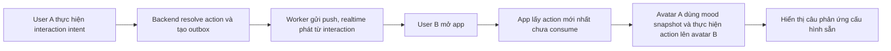

# Pilot Plan

## 1. Mục tiêu

Pilot kiểm chứng một câu hỏi duy nhất:

> Các cặp đôi Việt Nam có chủ động gửi và quay lại để xem các action ngắn thông qua avatar hay không?

Pilot không nhằm chứng minh toàn bộ ý tưởng avatar editor, shop, pet, room decoration hoặc social feature.

## 2. Nền tảng

- Android-first.
- React Native với Expo.
- Phân phối qua internal testing hoặc closed testing.
- iOS không phải điều kiện hoàn thành pilot đầu tiên.

## 3. Phạm vi Phase 1

### Bắt buộc

- Email OTP.
- Hồ sơ với display name.
- Một số avatar preset hoặc tùy chỉnh rất giới hạn.
- Pairing một bước bằng invitation code.
- Preview tối thiểu trước khi người nhận xác nhận.
- Phòng chung có hai avatar.
- Bốn interaction intent: chạm đầu partner, ôm, đói và nhớ.
- Chạm đầu resolve theo mood: `happy → HEAD_PAT`, `angry → BONK`, `sad → PUSH_AWAY`.
- Mood được user chủ động chọn và đồng bộ realtime.
- Realtime khi app đang mở.
- Push notification trên Android.
- Durable notification outbox và retry theo device.
- Ba chế độ nội dung notification: generic, sender-only và detailed.
- Khi mở app, phát animation của action mới nhất.
- Câu phản ứng cấu hình sẵn theo action.
- Tắt action và ngắt ghép đôi.
- Deactivate vô thời hạn có thể restore, unmatch riêng biệt và hard delete.
- Unmatch ẩn profile/avatar ngay và xóa interaction sau 10 ngày.

### Hoãn sang phase sau

- Bốn action còn lại.
- Avatar editor nhiều layer.
- Lịch sử interaction dành cho người dùng.
- Read receipt.
- Reply thread.
- Quiet hours theo timezone.
- Multi-device delivery hoàn chỉnh.
- iOS release.
- Widget.
- Rive hoặc Skia.

## 4. Interaction loop của pilot

Không có message tự do và không có luồng trả lời gắn trực tiếp vào interaction trước.

## 5. Phase 2 dự kiến

Chỉ triển khai khi Phase 1 cho thấy người dùng thực sự dùng core loop:

- Thêm `CHEEK_POKE`, `KISS`, `SLEEPY` và mood mapping cho các vùng khác.
- Mở rộng avatar customization.
- Notification preference chi tiết.
- Quiet hours.
- Interaction history nếu người dùng có nhu cầu.
- Công cụ vận hành delivery nâng cao và dashboard push.
- iOS build và test.

## 6. Phase 3 dự kiến

- Widget.
- Room decoration.
- Pet chung.
- Bộ đồ đôi.
- Rive/Skia animation nâng cao.
- Voice action ngắn.
- AI-generated sticker hoặc postcard.

## 7. Quan sát tùy chọn

Với dự án cá nhân, không bắt buộc phải đặt số lượng tester hoặc ngưỡng thành công trước khi code. Các chỉ số dưới đây chỉ hữu ích khi cần quyết định có nên đầu tư thêm thời gian vào feature hay không.

- Tỷ lệ đăng ký hoàn tất email OTP.
- Tỷ lệ hoàn tất pairing.
- Tỷ lệ cặp gửi action đầu tiên.
- Số cặp gửi action ở nhiều hơn một ngày.
- Số action trung bình mỗi cặp mỗi ngày.
- Tỷ lệ push được mở.
- Tỷ lệ người dùng tắt action hoặc notification.
- Tỷ lệ unpair/deactivate/delete.

Pilot không dùng read receipt hoặc `interaction_replied` làm chỉ số. Nếu chưa cần product analytics, chỉ giữ crash log, push delivery log và feedback trực tiếp từ tester.

## 8. Nội dung chỉ cần khi muốn tổ chức pilot chính thức

- Số lượng cặp tham gia, nếu muốn kết quả có tính so sánh.
- Thời gian quan sát, nếu muốn đánh giá việc quay lại sử dụng.
- Thiết bị Android tối thiểu được hỗ trợ.
- Ngưỡng pairing completion, nếu cần quyết định onboarding có phải sửa không.
- Ngưỡng cặp quay lại nhiều ngày, nếu cần quyết định tiếp tục đầu tư feature.
- Kênh thu thập feedback định tính.
- Privacy notice cho người tham gia pilot.
