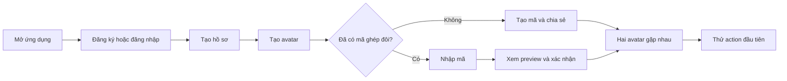
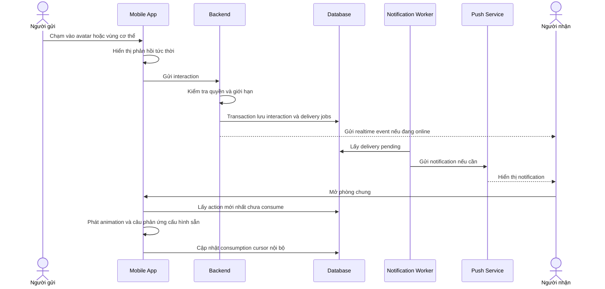

# Đặc tả sản phẩm Couple App

## 1. Tóm tắt

Couple App là ứng dụng di động cho phép hai người trong một mối quan hệ tạo avatar chibi, ghép đôi và thể hiện nhu cầu hoặc cảm xúc bằng cách tương tác trực tiếp với nhân vật của mình và đối phương.

Ứng dụng tập trung vào những tín hiệu ngắn, nhẹ nhàng và có tính vui vẻ. Người dùng không cần soạn một tin nhắn đầy đủ để nói rằng mình đang đói, buồn ngủ, nhớ người yêu hoặc muốn được quan tâm.

## 2. Vấn đề

Các ứng dụng nhắn tin hiện tại hỗ trợ văn bản, emoji và sticker nhưng vẫn yêu cầu người dùng chủ động nghĩ và gửi nội dung. Trong một mối quan hệ, nhiều tín hiệu nhỏ lặp lại hằng ngày không cần một cuộc hội thoại dài, nhưng vẫn quan trọng để tạo cảm giác kết nối.

Các vấn đề cần giải quyết:

- Người dùng muốn thể hiện cảm xúc nhanh hơn việc soạn tin nhắn.
- Sticker và emoji thiếu tính cá nhân vì không đại diện cho chính cặp đôi.
- Những tương tác nhỏ như xoa đầu, ôm hoặc báo đói khó được thể hiện tự nhiên khi hai người ở xa nhau.
- Một số ứng dụng cặp đôi có quá nhiều tính năng, tạo cảm giác phải duy trì streak hoặc báo cáo hoạt động cho nhau.

## 3. Tầm nhìn

Tạo ra một không gian số nhỏ, riêng tư và vui vẻ, nơi hai người có thể "chạm" vào nhau thông qua avatar mà không cần biến mọi cảm xúc thành một đoạn chat.

## 4. Giá trị cốt lõi

> Một hành động trực quan thay cho một câu nói ngắn.

Ứng dụng phải giúp người dùng hoàn thành một tương tác trong vài giây:

1. Mở app.
2. Chạm vào avatar.
3. Đối phương nhận được animation hoặc thông báo.
4. Khi đối phương mở app, avatar phát animation của action mới nhất.

## 5. Đối tượng người dùng

### Người dùng chính

- Các cặp đôi đang yêu tại thị trường Việt Nam, không giới hạn ở cặp đôi yêu xa.
- Người dùng quen với emoji, sticker, avatar và giao tiếp ngắn.
- Người dùng muốn một không gian riêng cho hai người nhưng không cần thay thế ứng dụng chat chính.

### Nhu cầu chính

- Gửi tín hiệu cảm xúc nhanh.
- Nhận phản hồi vui vẻ từ người yêu.
- Cá nhân hóa avatar để có cảm giác đây là nhân vật của mình.
- Giữ trải nghiệm riêng tư, không có feed công khai.

## 6. Nguyên tắc sản phẩm

### Nhanh

Một action phổ biến không nên cần nhiều hơn hai thao tác sau khi mở màn hình chính.

### Nhẹ nhàng

Ứng dụng không chấm điểm tình yêu, không phán xét tần suất tương tác và không tạo áp lực phải phản hồi.

### Đồng thuận

Mỗi người có thể tắt một loại action, tắt notification hoặc ngắt ghép đôi bất kỳ lúc nào.

### Riêng tư

Dữ liệu cặp đôi chỉ được đọc bởi hai thành viên của cặp. Không có feed công khai trong MVP.

### Cá nhân

Avatar, cách gọi và nội dung notification phải tạo cảm giác được gửi từ đúng người yêu của người nhận.

## 7. Phạm vi MVP

MVP cần kiểm chứng giả thuyết sau:

> Các cặp đôi có thường xuyên sử dụng và phản hồi các tương tác avatar ngắn hay không?

Pilot MVP Android bao gồm:

- Đăng nhập bằng email OTP.
- Tạo hồ sơ cơ bản.
- Tạo hoặc nhập mã ghép đôi.
- Người tạo mã được xem là đã consent; người nhập mã xem preview tối thiểu rồi xác nhận.
- Tạo avatar từ một số preset hoặc lựa chọn giới hạn.
- Hiển thị hai avatar trong phòng chung.
- Gửi bốn interaction intent pilot: chạm đầu partner, ôm, đói và nhớ. Chạm đầu được resolve theo mood thành xoa đầu, gõ đầu hoặc đẩy ra.
- Nhận action qua realtime khi đang mở app.
- Nhận push notification khi app ở background hoặc đã đóng.
- Khi mở app, chỉ phát animation của action mới nhất chưa được consume.
- Hiển thị câu phản ứng được cấu hình sẵn theo action, không có chat tự do.
- Tắt từng loại action.
- Ngắt ghép đôi và xóa tài khoản.
- Vô hiệu hóa tài khoản theo cơ chế soft delete có khả năng restore.

## 8. Ngoài phạm vi MVP

- Chat văn bản đầy đủ.
- Gọi thoại hoặc video.
- Theo dõi vị trí.
- Trạng thái online chi tiết hoặc last seen.
- Mạng xã hội hoặc feed công khai.
- AI tư vấn tình cảm.
- Chat hoặc message tự do do người dùng nhập.
- Marketplace và tiền ảo.
- Hệ thống streak có hình phạt.
- Phòng 3D hoặc game engine.
- Nhiều hơn một mối quan hệ đang hoạt động cho mỗi tài khoản.
- Lưu trữ album ảnh hoặc video dung lượng lớn.

## 9. Luồng người dùng chính

### 9.1 Onboarding

### 9.2 Gửi interaction

### 9.3 Ngắt ghép đôi

1. Người dùng mở cài đặt mối quan hệ.
2. Ứng dụng giải thích dữ liệu nào sẽ được giữ hoặc xóa.
3. Người dùng xác nhận ngắt ghép đôi.
4. Quan hệ chuyển sang trạng thái `ended` ngay lập tức.
5. Hai bên không thể gửi interaction mới cho nhau.
6. Notification đang chờ không được gửi tiếp.
7. Profile và avatar của partner bị ẩn ngay.
8. Interaction của couple được giữ 10 ngày rồi xóa tự động.

### 9.4 Vòng đời account

- Gỡ cài đặt app không làm account bị deactivate; user cài lại và đăng nhập OTP để tiếp tục.
- Deactivate là thao tác chủ động, tạm ẩn account và khóa interaction vô thời hạn.
- User có thể restore account đã deactivate bất cứ lúc nào.
- Unmatch chỉ kết thúc couple, không tự deactivate hai account.
- Hard delete là vĩnh viễn và xóa toàn bộ interaction liên quan.

## 10. Avatar

### Thành phần tùy chỉnh MVP

- Tông da.
- Kiểu tóc.
- Màu tóc.
- Mắt.
- Miệng.
- Trang phục.
- Một phụ kiện tùy chọn.

### Cách hiển thị

Avatar MVP được tạo bằng cách xếp các layer PNG hoặc SVG theo thứ tự cố định. Một avatar không cần hệ xương phức tạp trong giai đoạn đầu.

### Trạng thái cơ bản

- `idle`
- `happy`
- `surprised`
- `hungry`
- `sleepy`
- `sad`
- `receiving_action`

## 11. Action catalogue

| Mã action | Người dùng thao tác | Vùng chạm | Ý nghĩa | Phản hồi chính |
|---|---|---|---|---|
| `HEAD_PAT` | Avatar đối phương | Đầu | Xoa đầu | Avatar vui, icon trái tim nhỏ |
| `CHEEK_POKE` | Avatar đối phương | Má | Chọc má | Má lõm nhẹ, avatar bất ngờ |
| `BONK` | Avatar đối phương | Đầu hoặc mặt | Đánh yêu | Rung nhẹ, hiệu ứng ngôi sao |
| `PUSH_AWAY` | Avatar đối phương | Đầu | Muốn giữ khoảng cách | Hai avatar tách ra, biểu cảm buồn |
| `KISS` | Avatar đối phương | Má | Hôn má | Dấu hôn và trái tim |
| `HUG` | Kéo hai avatar lại gần | Toàn thân | Muốn ôm | Hai avatar tiến lại gần |
| `HUNGRY` | Avatar của mình | Miệng | Đang đói | Miệng mở, bụng kêu |
| `MISS_YOU` | Avatar của mình | Tim | Đang nhớ | Tim đập và bay về phía đối phương |
| `SLEEPY` | Avatar của mình | Mắt | Buồn ngủ | Dụi mắt và hiệu ứng ngủ |

`BONK` phải được trình bày là hành động trêu đùa. Người nhận có thể tắt riêng action này và nội dung notification không được mang tính bạo lực.

Pilot Phase 1 có bốn intent. Intent chạm đầu partner resolve theo mood người gửi: `happy → HEAD_PAT`, `angry → BONK`, `sad → PUSH_AWAY`. Mood người nhận không ảnh hưởng tới resolved action. Các intent còn lại là `HUG`, `HUNGRY` và `MISS_YOU`. `CHEEK_POKE`, `KISS` và `SLEEPY` thuộc Phase 2.

Khi người nhận mở app với partner-directed intent, avatar người gửi là actor và avatar người nhận là target. Actor đổi sang biểu cảm mood đã lưu tại thời điểm gửi rồi thực hiện animation lên target.

Quy tắc này áp dụng cho partner-directed intent như chạm đầu. Self-state intent như chạm miệng avatar của mình để báo đói hoặc chạm tim của mình để báo nhớ vẫn dùng avatar của sender làm nguồn trạng thái và không phụ thuộc mood trong Phase 1.

Mỗi action có thể ánh xạ tới một localization key phản ứng do app cấu hình, ví dụ `reaction.bonk.hurt` hoặc `reaction.cheekPoke.laugh`. Đây không phải nội dung do người dùng nhập.

## 12. Nội dung notification

Notification phải ngắn và tránh nội dung gây áp lực. Mặc định pilot sử dụng nội dung generic để giảm rủi ro lộ dữ liệu quan hệ trên lock screen.

| Chế độ | Ví dụ notification |
|---|---|
| `generic`, mặc định | "Bạn vừa nhận một action mới" |
| `sender_only` | "Bạn có tương tác mới từ Minh" |
| `detailed` | "Minh vừa xoa đầu bạn" |

Android notification channel phải dùng lock-screen visibility riêng tư phù hợp. Người dùng vẫn có toàn quyền thay đổi cách hiển thị notification trong system settings.

## 13. Yêu cầu chức năng

### Tài khoản

- `FR-AUTH-01`: Người dùng có thể tạo tài khoản.
- `FR-AUTH-02`: Người dùng có thể đăng nhập và đăng xuất.
- `FR-AUTH-03`: Session được khôi phục khi mở lại ứng dụng.
- `FR-AUTH-04`: Người dùng có thể vô hiệu hóa tài khoản vô thời hạn và restore bất cứ lúc nào.
- `FR-AUTH-05`: Người dùng có thể yêu cầu xóa hoàn toàn account và dữ liệu liên quan.
- `FR-AUTH-06`: Android production phải cung cấp đường xóa account trong app và web resource theo yêu cầu Google Play.
- `FR-AUTH-07`: Hard delete xóa toàn bộ interaction có user là sender hoặc receiver; partner cũng mất các interaction này.

### Ghép đôi

- `FR-PAIR-01`: Người dùng có thể tạo mã mời có thời hạn.
- `FR-PAIR-02`: Người khác có thể nhập mã hoặc mở deep link.
- `FR-PAIR-03`: Việc tạo mã là consent của người mời; người nhập mã phải xem preview tối thiểu và xác nhận trước khi quan hệ hoạt động.
- `FR-PAIR-04`: Một tài khoản chỉ có một quan hệ đang hoạt động.
- `FR-PAIR-05`: Một trong hai người có thể ngắt quan hệ.

### Avatar

- `FR-AVATAR-01`: Người dùng có thể chọn các thành phần avatar.
- `FR-AVATAR-02`: Ứng dụng lưu và đồng bộ cấu hình avatar.
- `FR-AVATAR-03`: Người yêu có thể nhìn thấy phiên bản avatar mới sau khi cập nhật.

### Interaction

- `FR-INT-01`: Pilot hỗ trợ bốn interaction intent; backend resolve action cuối cùng từ mood, vùng chạm và gesture.
- `FR-INT-02`: Mood V1 gồm `happy`, `angry`, `sad`; mặc định là `happy` và do user chủ động thay đổi.
- `FR-INT-03`: Backend phải xác minh hai người đang trong cùng một quan hệ hoạt động.
- `FR-INT-04`: Backend phải từ chối resolved action bị người nhận tắt.
- `FR-INT-05`: Interaction và notification outbox được lưu cùng transaction.
- `FR-INT-06`: Người nhận mở app từ notification và phòng chung phát action mới nhất chưa được consume.
- `FR-INT-07`: Các action là độc lập; MVP không tạo reply thread hoặc read receipt.

### Cài đặt

- `FR-SET-01`: Người dùng có thể bật hoặc tắt từng action.
- `FR-SET-02`: Người dùng có thể tắt toàn bộ push notification.
- `FR-SET-03`: Người dùng chọn một trong ba chế độ nội dung notification: generic, tên người gửi hoặc chi tiết action.
- `FR-SET-04`: Quiet hours là tính năng phase sau, không phải blocker của pilot.

## 14. Yêu cầu phi chức năng

- `NFR-01`: Một interaction online nên xuất hiện ở thiết bị người nhận trong vòng 2 giây ở điều kiện mạng bình thường.
- `NFR-02`: Màn hình chính phải giữ animation mượt ở mức mục tiêu 60 FPS trên thiết bị tầm trung.
- `NFR-03`: Không có service role key hoặc secret backend nào nằm trong mobile app.
- `NFR-04`: Mọi bảng dữ liệu người dùng phải có Row Level Security.
- `NFR-05`: App phải phục hồi hợp lý khi offline và không gửi trùng interaction do retry.
- `NFR-06`: Tất cả thao tác quan trọng phải có loading, success và error state.
- `NFR-07`: Người dùng có thể sử dụng chức năng chính với font scaling tiêu chuẩn của hệ điều hành.

## 15. Chống spam và lạm dụng

- Giới hạn số push notification cùng loại trong một khoảng thời gian.
- Các interaction vượt giới hạn có thể vẫn được lưu nhưng không phát push.
- Cho phép tắt từng action.
- Cho phép mute tạm thời toàn bộ interaction.
- Sau khi ngắt ghép đôi, mọi request mới phải bị backend từ chối.
- Không cho phép client tự chỉ định `receiver_id` ngoài quan hệ đang hoạt động.
- Ghi nhận lý do backend từ chối để theo dõi lỗi và hành vi lạm dụng.

Khi action bị tắt, backend từ chối trước khi lưu, realtime hoặc push. Setting tắt push là một setting riêng và không chặn interaction trong app.

Giới hạn ban đầu đề xuất: tối đa 5 push notification cùng loại trong 10 phút cho một cặp. Giá trị này phải có thể cấu hình và điều chỉnh sau thử nghiệm.

## 16. Tín hiệu đánh giá tùy chọn

Đây là các tín hiệu hữu ích nếu chủ dự án muốn biết feature nào đáng tiếp tục đầu tư. Chúng không phải điều kiện để bắt đầu hoặc hoàn thành dự án cá nhân. V1 có thể chỉ dùng crash log, push delivery log và feedback trực tiếp.

### Activation

- Tỷ lệ tài khoản hoàn tất tạo avatar.
- Tỷ lệ người dùng hoàn tất ghép đôi.
- Tỷ lệ cặp gửi interaction đầu tiên.

### Engagement

- Số interaction trung bình mỗi cặp mỗi ngày.
- Tỷ lệ notification dẫn tới việc mở app.
- Tỷ lệ cặp gửi action ở nhiều hơn một ngày.
- Phân bố usage theo loại action.

### Retention

- Tỷ lệ cặp quay lại ngày 1, ngày 7 và ngày 30.
- Số ngày hoạt động trung bình của một cặp trong 30 ngày.

### Safety

- Tỷ lệ action bị tắt.
- Tỷ lệ người dùng tắt push notification.
- Số request bị rate limit.
- Tỷ lệ ngắt ghép đôi và xóa tài khoản.

## 17. Dấu hiệu tích cực ban đầu

MVP được xem là có tín hiệu tốt khi nhóm thử nghiệm cho thấy:

- Phần lớn cặp thử nghiệm hoàn tất ghép đôi mà không cần hỗ trợ trực tiếp.
- Ít nhất một nửa số cặp đã ghép đôi gửi interaction trong ngày đầu.
- Cặp đôi quay lại gửi action ở nhiều hơn một ngày trong thời gian pilot.
- Người dùng hiểu các vùng tương tác mà không cần hướng dẫn dài.
- Không xuất hiện phản hồi nghiêm trọng về spam, kiểm soát hoặc quyền riêng tư.

Không bắt buộc đặt ngưỡng số cụ thể nếu dự án chưa tổ chức pilot chính thức.

## 18. Rủi ro

| Rủi ro | Tác động | Hướng giảm thiểu |
|---|---|---|
| Thiếu asset chibi đồng nhất | Avatar kém hấp dẫn | Bắt đầu với ít lựa chọn nhưng cùng một phong cách |
| Animation tốn nhiều công | Chậm ra MVP | Dùng layer và transform đơn giản trước Rive |
| Notification gây phiền | Người dùng tắt app | Rate limit, quiet hours và action settings |
| Tương tác bị hiểu sai | Ảnh hưởng trải nghiệm | Nội dung vui vẻ, consent và tắt từng action |
| Scope tăng quá nhanh | Không kiểm chứng được core loop | Giữ chat, AI, shop và game ngoài MVP |
| Realtime không ổn định | Mất cảm giác trực tiếp | Lưu event trước, retry có idempotency và fallback push |

## 19. Câu hỏi mở

- Avatar preset đầu tiên cần bao nhiêu lựa chọn để đủ kiểm chứng mà không làm chậm pilot?
- Lịch sử interaction nên được giữ mặc định trong bao lâu?
- Action `HUG` nên dùng thao tác kéo avatar hay chọn từ action sheet để dễ sử dụng hơn?
- Backup và log kỹ thuật giữ dấu vết của hard delete trong bao lâu?
