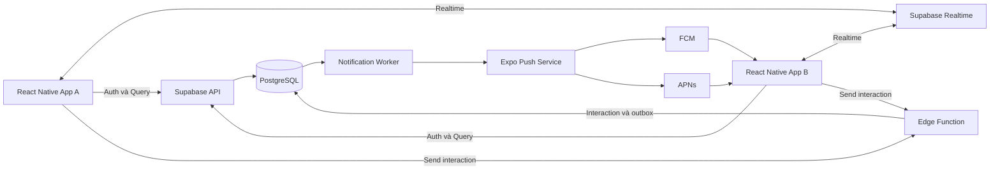
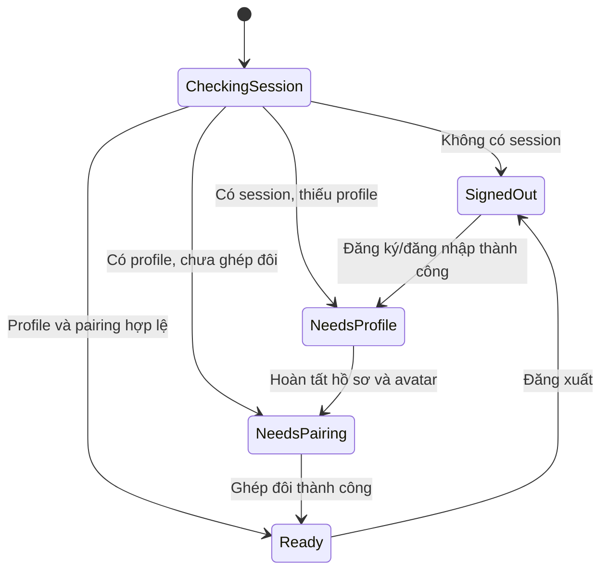
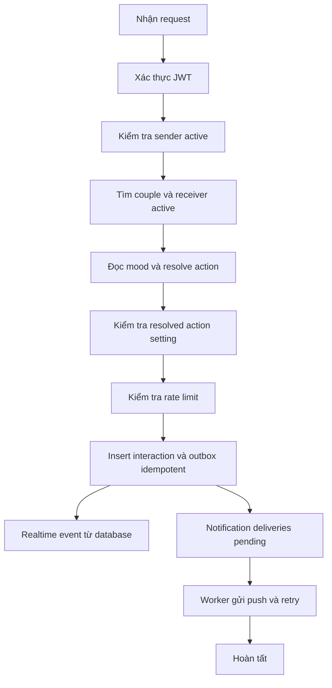

# Kiến trúc kỹ thuật Couple App

## 1. Mục tiêu kiến trúc

Kiến trúc MVP cần ưu tiên:

- Android-first cho pilot, giữ khả năng mở rộng iOS bằng cùng codebase React Native.
- Ra phiên bản thử nghiệm nhanh.
- Realtime đủ tốt cho interaction giữa hai người.
- Push notification đáng tin cậy khi người nhận không mở app.
- Phân quyền ở backend, không tin dữ liệu do mobile tự khai báo.
- Có đường nâng cấp animation mà không phải viết lại toàn bộ ứng dụng.
- Chi phí vận hành thấp trong giai đoạn thử nghiệm.

## 2. Stack đã chọn

### Mobile

| Thành phần | Công nghệ | Vai trò |
|---|---|---|
| Framework | React Native | Ứng dụng iOS và Android |
| Toolchain | Expo | Development build, cấu hình native và release |
| Ngôn ngữ | TypeScript | Type safety và dùng chung contract |
| Navigation | Expo Router | File-based routing và deep linking |
| Gesture | React Native Gesture Handler | Tap, pan và gesture trên avatar |
| Animation | React Native Reanimated | Animation chạy trên UI thread |
| Notification | Expo Notifications | Đăng ký token và nhận push |
| Storage local | Expo SecureStore | Token hoặc dữ liệu nhạy cảm cục bộ |
| Localization | Thư viện i18n được chọn sau spike | Tiếng Việt với fallback tiếng Anh |
| Error monitoring | Sentry hoặc Crashlytics | Theo dõi crash và lỗi runtime |

### Backend

| Thành phần | Công nghệ | Vai trò |
|---|---|---|
| Authentication | Supabase Auth | Tài khoản và session |
| Database | PostgreSQL qua Supabase | Dữ liệu người dùng và interaction |
| Authorization | Row Level Security | Giới hạn truy cập theo người dùng/cặp đôi |
| Realtime | Supabase Realtime | Đồng bộ interaction khi đang online |
| Server logic | Supabase Edge Functions | Gửi action, rate limit và push |
| File storage | Supabase Storage | Asset tùy chỉnh trong tương lai |
| Push transport | Expo Push Service, FCM, APNs | Gửi notification tới thiết bị |

### Delivery

| Thành phần | Công nghệ | Vai trò |
|---|---|---|
| Mobile build | EAS Build | Build Android/iOS |
| OTA update | EAS Update | Cập nhật JavaScript an toàn |
| CI | GitHub Actions | Lint, typecheck và test |
| Database migrations | Supabase CLI | Quản lý schema có version |

## 3. Sơ đồ tổng thể



## 4. Ranh giới trách nhiệm

### Mobile app chịu trách nhiệm

- Hiển thị UI và avatar.
- Thu nhận gesture.
- Chạy animation phản hồi tức thời.
- Quản lý navigation và deep link.
- Quản lý session phía client.
- Subscribe realtime event đúng phạm vi.
- Đăng ký và cập nhật push token.
- Cache dữ liệu cần thiết để hiển thị khi mạng yếu.
- Retry có kiểm soát khi request thất bại.

### Backend chịu trách nhiệm

- Xác thực người gửi.
- Xác định quan hệ đang hoạt động của người gửi.
- Tự xác định người nhận, không tin `receiver_id` từ client.
- Kiểm tra action có được người nhận cho phép hay không.
- Áp dụng rate limit; quiet hours được thêm ở Phase 2.
- Ghi interaction với idempotency key.
- Gửi push notification khi phù hợp.
- Bảo vệ dữ liệu bằng Row Level Security.
- Vô hiệu hóa quyền gửi ngay khi quan hệ kết thúc.

## 5. Cấu trúc source dự kiến

Cấu trúc này là định hướng cho giai đoạn viết code, chưa được tạo trong repo hiện tại.

```text
src/
├── app/                     # Route và layout của Expo Router
├── components/              # Component dùng chung, không chứa business rule
├── features/
│   ├── auth/
│   ├── profile/
│   ├── pairing/
│   ├── avatar/
│   ├── interactions/
│   ├── notifications/
│   └── settings/
├── services/
│   ├── supabase/
│   ├── notifications/
│   └── monitoring/
├── stores/                  # Client state thực sự cần chia sẻ
├── theme/                   # Token màu, spacing và typography
├── i18n/                    # Locale vi/en và fallback configuration
├── types/                   # Type và contract dùng chung
├── utils/
└── assets/
    └── avatars/
```

Nguyên tắc:

- Business logic đặt gần feature sử dụng nó.
- Không tạo global state cho dữ liệu có thể lấy từ server query.
- Component dùng chung không được gọi Supabase trực tiếp.
- Mọi truy cập backend đi qua service hoặc repository rõ ràng.
- Contract action dùng enum/type thống nhất giữa mobile và Edge Function.
- Màu, spacing và typography chỉ được dùng qua theme token tập trung.
- Text hiển thị và câu phản ứng chỉ được dùng qua localization key.

## 6. Luồng authentication



Production đăng nhập bằng email OTP. Local development dùng Supabase local mail viewer hoặc development-only test flow không xuất hiện trong production build.

Mobile chỉ dùng anon key của Supabase. Service role key chỉ tồn tại trong môi trường server/Edge Function.

## 7. Luồng pairing

### Tạo mã

1. Người dùng đã đăng nhập yêu cầu tạo invitation.
2. Backend kiểm tra người dùng chưa có quan hệ đang hoạt động.
3. Backend tạo mã ngẫu nhiên có thời hạn và chỉ lưu hash nếu cần tăng bảo mật.
4. App hiển thị mã và deep link để chia sẻ.

### Chấp nhận mã

1. Người nhận nhập mã hoặc mở deep link.
2. Backend kiểm tra mã tồn tại, chưa hết hạn và không thuộc chính người nhập.
3. Backend hiển thị thông tin tối thiểu của người mời.
4. Người nhận xác nhận.
5. Việc tạo invitation được xem là consent của người mời; confirmation của người nhập là bước consent cuối cùng.
6. Backend tạo `couple`, hai `couple_members` và hai `active_couple_memberships` trong một transaction.
7. Nếu một active membership đã tồn tại, toàn bộ transaction bị reject.
8. Invitation chuyển sang trạng thái đã sử dụng.

Không có bước người mời xác nhận lần hai trong pilot.

### Active membership invariant

Việc kiểm tra "user chưa có couple active" ở application layer là chưa đủ vì hai request accept có thể chạy đồng thời. Database phải có một invariant có thể khóa hoặc reject request thứ hai.

Các phương án:

| Phương án | Ưu điểm | Nhược điểm |
|---|---|---|
| Bảng `active_couple_memberships` với `user_id` unique | Dễ query, database tự chặn hai couple active | Cần đồng bộ insert/delete khi activate hoặc end couple |
| `active_couple_id` trên profile | Rất đơn giản khi tìm couple hiện tại | Trộn profile với relationship state và cần transaction cập nhật hai user |
| Transaction lock/advisory lock | Không cần bảng phụ | Khó hiểu, khó test và dễ dùng sai hơn |
| Chỉ check ở application | Ít code ban đầu | Không an toàn khi có request đồng thời, không được khuyến nghị |

V1 sử dụng bảng `active_couple_memberships` với `user_id` unique. Đây là invariant do database đảm bảo, không chỉ là convention ở application layer.

## 8. Luồng gửi interaction

Client không insert trực tiếp vào bảng `interactions`. Client gọi Edge Function để đảm bảo validation và push notification dùng cùng một luồng.

### Request từ mobile

```json
{
  "targetType": "partner",
  "targetRegion": "head",
  "gesture": "tap",
  "clientEventId": "uuid-generated-on-device",
  "clientCreatedAt": "2026-10-18T10:30:00Z"
}
```

Client không gửi `senderId`, `receiverId`, `coupleId` hoặc resolved action như nguồn dữ liệu đáng tin cậy. Backend lấy sender từ JWT, đọc mood authoritative, suy ra couple/receiver và resolve action từ `mood + targetRegion + gesture`.

### Xử lý backend



### Idempotency

`clientEventId` phải unique theo sender. Nếu mobile retry do timeout, backend trả lại interaction đã tồn tại thay vì tạo interaction mới.

### Mood-based resolution

V1 có `happy`, `angry`, `sad`. Mood mặc định là `happy`, do user chủ động đổi và được đồng bộ realtime cho partner.

Chỉ mood của sender được dùng để resolve action. Mood của receiver không được đọc trong action resolution.

Mood-based resolution áp dụng cho partner-directed intent. Self-state intent như `self_mouth` và `self_heart` giữ mapping cố định trong Phase 1.

Mapping vùng đầu:

- `happy + head + tap → HEAD_PAT`
- `angry + head + tap → BONK`
- `sad + head + tap → PUSH_AWAY`

Interaction lưu cả resolved action, actor mood, target region và gesture để debug và tái hiện đúng behavior. Chi tiết nằm trong `mood-action-matrix.md`.

Khi render interaction trên thiết bị receiver:

- `sender_id` xác định actor hoặc subject avatar.
- Với `targetType = partner`, `receiver_id` xác định target avatar.
- Với `targetType = self`, avatar sender tự chạy trạng thái/animation; receiver là người quan sát, không nhất thiết là target vật lý.
- Actor avatar áp dụng `actor_mood` snapshot trước khi chạy action animation.
- Target avatar chỉ chạy reaction animation khi interaction có target partner.
- Client không đảo actor/target chỉ vì receiver đang là current user.

### Consumption model

Các action là độc lập, không có reply thread và không có read receipt công khai. Khi app mở phòng chung:

1. Backend trả interaction mới nhất sau consumption cursor `(couple_id, created_at, id)` của người nhận trong couple hiện tại.
2. App phát đúng một animation và câu phản ứng cấu hình sẵn.
3. App cập nhật cursor bằng server `created_at` và interaction `id` vừa consume.
4. Các interaction cũ hơn cursor không được phát tuần tự.

Consumption cursor là trạng thái kỹ thuật riêng của người nhận, không được trả cho partner như trạng thái đã xem.

## 9. Realtime

Mobile subscribe các thay đổi interaction thuộc quan hệ đang hoạt động. RLS và filter phải giới hạn dữ liệu về đúng cặp đôi.

Khi nhận event:

1. Bỏ qua event do chính thiết bị vừa gửi nếu đã chạy optimistic animation.
2. Kiểm tra interaction chưa được xử lý trong local session.
3. Nếu đang ở phòng chung, chọn action mới nhất và chạy animation.
4. Nếu đang ở màn hình khác, hiển thị in-app banner nhẹ.

Realtime không thay thế persistence. Nguồn dữ liệu cuối cùng vẫn là PostgreSQL.

## 10. Push notification

### Đăng ký thiết bị

- Mỗi lần đăng nhập hoặc token thay đổi, app upsert device record.
- Một user có thể có nhiều device.
- Device token bị lỗi vĩnh viễn phải được đánh dấu inactive.
- Khi đăng xuất, app vô hiệu hóa device session tương ứng nếu có thể.

### Quy tắc gửi

Push được gửi khi:

- Interaction hợp lệ.
- Người nhận cho phép push.
- Action không bị tắt.
- Khi Phase 2 có quiet hours, notification phải tôn trọng timezone và khoảng giờ đã cấu hình.
- Chưa vượt rate limit.

Push hỗ trợ ba chế độ nội dung:

- `generic`, mặc định: không chứa tên hoặc action.
- `sender_only`: chứa tên hiển thị của người gửi nhưng không chứa action.
- `detailed`: chứa tên và action.

Payload luôn chứa interaction identifier cần thiết để app tải dữ liệu có quyền truy cập. Chế độ nội dung được đọc từ setting của người nhận tại thời điểm worker gửi push.

### Độ tin cậy của push

Nếu Edge Function insert interaction rồi gọi push provider trực tiếp, có thể xảy ra trường hợp interaction đã lưu nhưng function lỗi trước khi gửi push. Retry cũng có thể gặp interaction đã tồn tại nhưng không biết cần gửi lại notification hay không.

V1 sử dụng durable outbox:

1. Interaction và outbox record được tạo trong cùng transaction.
2. Worker lấy các delivery đang pending.
3. Worker kiểm tra lại sender/receiver active, couple active, action setting và device active.
4. Worker gửi push và lưu provider ticket theo device.
5. Lỗi tạm thời được retry có giới hạn; lỗi token vĩnh viễn vô hiệu hóa device.

Trên Android:

- Xin quyền `POST_NOTIFICATIONS` theo ngữ cảnh trên Android 13+.
- Tạo notification channel có tên rõ ràng.
- Dùng lock-screen visibility `PRIVATE` cho channel tương tác.
- Khi app foreground, notification handler có thể suppress system banner và chỉ hiển thị animation/in-app banner.
- Dùng cùng `collapseId` cho các interaction của một couple để coalesce message đang chờ truyền.
- Dùng cùng Android `tag` cho một couple để notification mới thay notification cũ đã hiển thị, phù hợp nguyên tắc chỉ quan tâm action mới nhất.

### Deep link

Ví dụ định dạng nội bộ:

```text
coupleapp://interactions/<interaction-id>
```

Khi mở link, app phải:

1. Khôi phục session.
2. Kiểm tra người dùng có quyền đọc interaction.
3. Điều hướng tới phòng chung.
4. Lấy action mới nhất chưa consume, phát animation và cập nhật cursor nội bộ.

Tham chiếu Expo Push Service: https://docs.expo.dev/push-notifications/sending-notifications/

## 11. Avatar và animation

### MVP

- Asset theo layer PNG hoặc SVG.
- Cấu hình avatar lưu dưới dạng các ID asset đã chọn.
- React Native render các layer theo thứ tự cố định.
- Gesture Handler xác định tap/pan.
- Reanimated xử lý translate, scale, rotate và opacity.
- Câu phản ứng theo action được lấy từ localization key, không phải nội dung tự do.
- Asset V1 được khai báo bằng manifest đóng gói trong app với ID ổn định và provenance/license record.

### Không làm trong MVP

- Bone animation phức tạp.
- Physics engine.
- Đồng bộ frame animation qua network.
- Tải executable animation từ nguồn không tin cậy.

### Đường nâng cấp

Nếu sprite/layer không đủ, có thể bổ sung Rive cho state machine hoặc React Native Skia cho scene phức tạp. Contract interaction không phụ thuộc renderer, do đó có thể thay renderer mà không đổi backend.

## 12. State management

Phân loại state:

| Loại state | Nơi quản lý |
|---|---|
| Session | Supabase client và auth provider |
| Server data | Query layer/cache |
| Realtime updates | Merge vào query cache |
| Form state | Local component/form library |
| Animation state | Reanimated shared values |
| UI state ngắn hạn | Local component state |
| Settings cần dùng toàn app | Store nhỏ hoặc provider |

Không đưa toàn bộ server data vào một global store duy nhất.

## 13. Offline và retry

- Cache profile, avatar và couple summary để phòng chung vẫn hiển thị được.
- Không giả vờ interaction đã gửi thành công khi offline.
- Có thể tạo pending action cục bộ với trạng thái rõ ràng.
- Retry dùng cùng `clientEventId` để tránh duplicate.
- Khi quan hệ đã kết thúc trong lúc thiết bị offline, backend từ chối action lúc reconnect.
- UI phải cho phép bỏ pending action thay vì retry vô hạn.

## 14. Bảo mật

### Nguyên tắc

- Không tin `user_id`, `couple_id` hoặc `receiver_id` do client gửi.
- Mọi bảng chứa dữ liệu người dùng đều bật RLS.
- Service role key không xuất hiện trong mobile bundle.
- Edge Function xác minh JWT và quan hệ trước thao tác.
- Invitation code có entropy đủ lớn và có thời hạn.
- Không ghi push token hoặc nội dung riêng tư vào log công khai.
- Không đưa email, token hoặc secret vào Git.
- Dữ liệu profile hiển thị cho partner phải đi qua view/RPC/API chỉ trả field được phép; RLS không tự ẩn từng column.
- Profile/avatar API chỉ trả partner khi cả hai account active và active membership còn tồn tại.
- Send interaction phải reject nếu sender hoặc receiver đang deactivated.

### Deactivate và delete account

- Deactivate là soft delete: ẩn tài khoản, khóa interaction và không tự xóa dữ liệu.
- Deactivate có thể restore bất cứ lúc nào; uninstall app không tự deactivate account.
- Delete là hard delete request: không được thay thế bằng deactivate.
- Hard delete xóa mọi interaction có user là sender hoặc receiver; partner cũng mất các interaction đó.
- Unmatch ẩn profile/avatar partner ngay, khóa interaction và xóa interaction của couple sau 10 ngày.
- Production Android phải có đường yêu cầu xóa trong app và một web resource theo yêu cầu Google Play.
- Hard delete treatment của interaction đã được chốt; chỉ retention của backup/log kỹ thuật còn mở.

### Threats chính

| Threat | Biện pháp |
|---|---|
| Đọc interaction của cặp khác | RLS theo membership |
| Gửi action cho user bất kỳ | Backend tự suy ra receiver |
| Spam push | Rate limit theo sender, receiver và action |
| Dùng lại invitation | Trạng thái single-use và expiry |
| Request gửi trùng | Unique idempotency key |
| Device token cũ | Theo dõi trạng thái active và lỗi provider |
| Người cũ gửi sau khi chia tay | Kiểm tra couple status mỗi lần gửi |

## 15. Observability

### Mobile

- Crash rate.
- App start failure.
- Lỗi navigation/deep link.
- Lỗi đăng ký push token.
- Animation frame drop ở phòng chung.

### Backend

- Số interaction thành công/thất bại.
- Latency của Edge Function.
- Tỷ lệ duplicate request.
- Tỷ lệ push accepted/rejected.
- Số request bị rate limit.
- Số request bị từ chối do quan hệ không hợp lệ.

Log không được chứa nội dung nhạy cảm ngoài dữ liệu kỹ thuật tối thiểu.

## 16. Môi trường

Tối thiểu có ba môi trường:

| Môi trường | Mục đích |
|---|---|
| Local | Phát triển và Supabase local |
| Staging | Internal build và pilot có kiểm soát |
| Production | Người dùng thật |

Mỗi môi trường dùng Supabase project, notification credential và EAS profile riêng. Không dùng database production cho development.

## 17. CI/CD dự kiến

Pull request hoặc push branch chạy:

1. Install dependency bằng lockfile.
2. Format check.
3. ESLint.
4. TypeScript typecheck.
5. Unit test.
6. Test schema hoặc migration nếu có.

Build staging chạy khi merge vào nhánh được chọn hoặc trigger thủ công. Production release luôn cần bước xác nhận thủ công trong giai đoạn MVP.

## 18. Quyết định hoãn lại

- Chọn thư viện query/state cụ thể sau khi khởi tạo spike.
- Chọn Sentry hay Crashlytics sau khi xác định nhu cầu analytics.
- Chọn Rive hoặc Skia chỉ sau khi asset layer chứng minh không đủ.
- Không xây abstraction backend riêng trước Supabase nếu chưa có nhu cầu thực tế.
- Chọn thư viện i18n cụ thể trong spike, nhưng contract `vi` với fallback `en` đã được chốt.
- Chọn retention của backup/log kỹ thuật sau hard delete.
- Chọn mood/action mapping cho các vùng ngoài vùng đầu.
